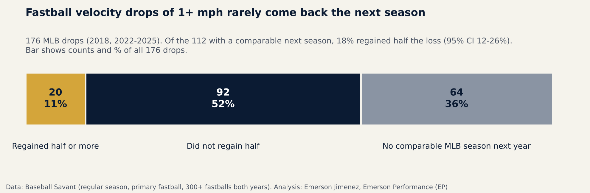
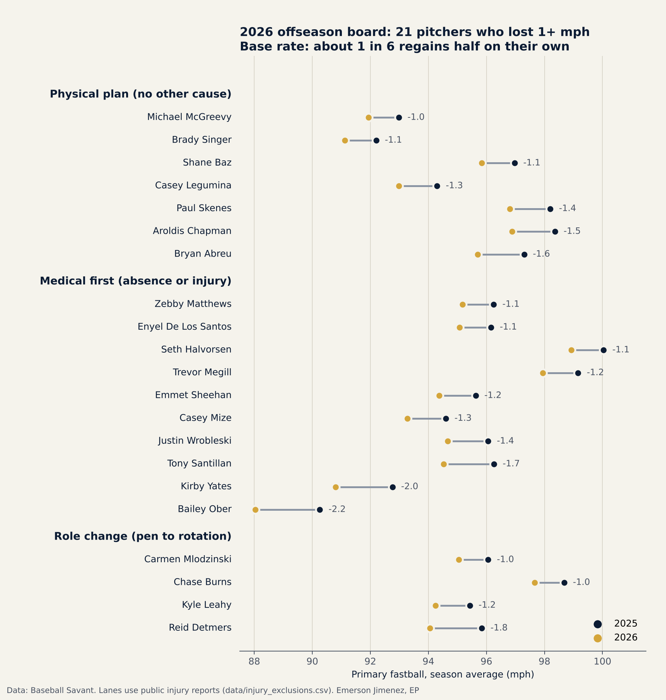

# EP Pitcher Velocity Plan

**When a fastball loses 1+ mph, waiting rarely works.** Of 112 MLB pitchers who lost at least 1 mph on their primary fastball and pitched a comparable season the next year, only **18% regained half the loss** (95% CI 12–26%). Another 64 of the 176 drops (36%) had no comparable MLB season the following year.

*English first · [Español abajo](#español)*



| Result | Numbers | Label |
|---|---|---|
| Drops of 1+ mph that regained half the loss the next season | 20 of 112 = 18% (95% CI 12–26%); binomial test vs 50%: p < 0.001 | **CONFIRMED** |
| Drops that regained the **full** loss | 5 of 112 ≈ 4–5% | CONFIRMED (descriptive) |
| Any of six explanations (absence, role change, age 30+, early vs late drop, in-season fade, drop size) predicts who recovers | No split passed (all BH q ≥ 0.41) | NOT CONFIRMED |
| A leave-one-out model predicts who recovers | AUC 0.54 (95% CI 0.40–0.67) | NOT CONFIRMED |
| Robustness: even if all 64 drops with no comparable next season had recovered | 84 of 176 = 48%, still under half | CONFIRMED (bound) |
| Robustness: without 2018, the largest event year | 15 of 72 = 21% (95% CI 13–32%) | CONFIRMED (holds) |
| A drop comes with losing a comparable MLB season next year (vs stable pitchers) | 36% vs 28%, p = 0.044, but 8.4 points is below the 10-point practical threshold | NOT CONFIRMED |

**Front-office question:** *Which pitchers who lost velocity in 2026 need an offseason physical intervention, and which should see the medical staff first?*

**Practical conclusion:** The natural-recovery rate is low, and nothing in the public data picks out the pitchers who will recover on their own. Waiting for velocity to come back is the low-percentage option. Every unexplained drop should get a plan, and every drop with an injury or absence should get a medical review first.

---

## The 2026 board

21 pitchers lost 1+ mph on their primary fastball from 2025 to 2026 (300+ fastballs in both seasons). Each one was checked for injuries in public reports before being assigned a lane ([`data/injury_exclusions.csv`](data/injury_exclusions.csv), with sources).



| Lane | Pitchers | What it means |
|---|---|---|
| **PHYSICAL PLAN** (7) | Bryan Abreu, Aroldis Chapman, Paul Skenes, Casey Legumina, Shane Baz, Brady Singer, Michael McGreevy | No injury or absence explains the drop. Start the 12-week plan. |
| **MEDICAL FIRST** (10) | Bailey Ober, Kirby Yates, Tony Santillan, Justin Wrobleski, Casey Mize, Emmet Sheehan, Seth Halvorsen, Zebby Matthews, Trevor Megill, Enyel De Los Santos | A 14+ day gap, late start, early end, or a reported injury (Megill: flexor strain in Aug 2025; De Los Santos: season-ending knee tendinitis). Medical clearance before velocity work. |
| **ROLE CHANGE** (4) | Reid Detmers, Kyle Leahy, Chase Burns, Carmen Mlodzinski | Moved from the bullpen to the rotation. A drop is expected; compare them against starters. |

Notes from the injury check (annotate, not exclude): McGreevy pitched through a sprained ankle in spring and believes it affected his mechanics, a lower-body cause the plan targets. Singer had a bruised foot in May. Chapman (38) had day-to-day lat tightness in September; age is his main alternative explanation. Abreu's June absence was a personal matter (3 days). Full table: [`outputs/board_2026.csv`](outputs/board_2026.csv).

**Case study:** Paul Skenes is on the physical-plan lane (−1.4 mph, no injury reported). His 2026 fastball velocity and spin decline is analyzed in depth in [`mlb-skenes-intelligence`](https://github.com/ejimenezperformance/mlb-skenes-intelligence).

**Not a medical judgment.** The lanes use public data only. A team's medical and performance staff have information this repo does not.

## The 12-week plan (INTERPRETATION)

Week 0 gate and screen (shoulder range of motion, CMJ and drop-jump RSI on force plates, lateral-to-medial jump, radar baseline) → weeks 1–4 restore → weeks 5–8 strength and frontal-plane power → weeks 9–12 reactive power and a mound progression. No weighted-ball overload program. Monitoring metric: bullpen velocity vs the 2025 Statcast average, with CMJ, RSI and range of motion as guardrails.

Full plan and references: [`docs/offseason_plan.md`](docs/offseason_plan.md). The data in this repo do **not** test the plan; next season, the same Statcast test can measure whether planned pitchers beat the 18% base rate.

---

## Method

**Data.** Baseball Savant Statcast Search, regular season only, grouped by pitcher and game: four-seam (FF) and sinker (SI) pulled separately, 2017–2026. Ages from the Savant custom leaderboard. `src/pull_data.py` downloads everything; the raw CSVs are not committed.

**Velocity.** Each pitcher's season average on his primary fastball (the type he threw most), weighted by pitches. A pitcher whose primary fastball changed type between seasons is not compared.

**Drop.** Season velocity in year *t* at least 1.0 mph below year *t−1*, with 300+ fastballs in both. Event years: 2018 and 2022–2025. Pairs that touch 2020 (short season, and the 2020 switch in tracking systems) are left out.

**Outcome.** In year *t+1* with 200+ fastballs: *recovered* = regained at least half the drop. No comparable season (fewer than 200 fastballs, no MLB fastballs, or a different primary fastball) is its own category, not a failure to recover.

**Comparison line.** Pitchers whose velocity stayed within ±0.5 mph lost 0.16 mph on average the next year. Pitchers with a drop regained 0.04 mph on average (Mann-Whitney p = 0.012, Cohen's d = 0.24): a small bounce, far smaller than the drop.

**Absence filter (automatic).** A 14+ day gap between appearances, first game after May 1, or last game before Sep 1. This flags injuries but also option trips to the minors, so it is called "absence," not "injury."

**Alternative explanations.** Each drop was classified by absence, role change (bullpen to rotation), whether velocity was already down in the first five games, in-season fade (1+ mph from the first half to the second), age 30+, and drop size 2+ mph. Fisher exact tests with Benjamini-Hochberg correction; CONFIRMED needs q < 0.05 **and** a difference of at least 10 percentage points. Results: [`outputs/recovery_by_explanation.csv`](outputs/recovery_by_explanation.csv).

**Prediction test.** Logistic regression with leave-one-out cross-validation; AUC with a paired bootstrap 95% CI (2,000 resamples). CONFIRMED needs a CI lower bound above 0.5 and AUC ≥ 0.60.

**Known-answer tests.** `tests/test_synthetic.py` builds fake data where absence raises recovery, lowers it, or has no effect. The code returns CONFIRMED, CONFIRMED and NOT CONFIRMED, as it should, before any real data is used.

**Sensitivity.** The low recovery rate holds for drops of 1.0 or 1.5 mph and for a 100- or 200-fastball minimum in the next season (15.8–18.6%). With drops of 2+ mph the sample is too small to read (n = 7–8). Full grid: [`outputs/sensitivity.csv`](outputs/sensitivity.csv). Two extra checks in [`outputs/robustness.json`](outputs/robustness.json): the optimistic bound (every missing next season counted as recovered: 48%) and the result without 2018, the year with the most drops (21%).

**Language.** "Came with," not "caused." This is an observational study.

### Limitations

- Statcast does not record injuries. The 2026 injury check used public reports; the historical baseline uses the automatic absence filter only.
- Season averages hide in-game and in-season changes; a pitcher can be healthy and still lose velocity late in a long season.
- Pitchers who left MLB may have recovered elsewhere (minors, other leagues); they are counted as "no comparable MLB season," not as failures.
- The baseline is what happened with whatever each team did. It is not a no-treatment control.

## Reproduce

```bash
pip install -r requirements.txt
python src/pull_data.py 2017 2026      # ~140 requests to Baseball Savant
python tests/test_synthetic.py         # known-answer tests
cd src
python run_baseline.py                 # natural recovery, tests, model
python sensitivity.py                  # threshold grid + robustness checks
python apply_2026.py                   # 2026 board (reads data/injury_exclusions.csv)
python charts.py
```

## Corrections log

None yet. Any correction will be listed here with the date and the files affected.

---

## Español

**Cuando una recta pierde 1+ mph, esperar casi nunca funciona.** De 112 pitchers de MLB que perdieron al menos 1 mph en su recta principal y lanzaron una temporada comparable al año siguiente, solo el **18% recuperó la mitad de lo perdido** (IC 95%: 12–26%). Otras 64 de las 176 caídas (36%) no tuvieron una temporada comparable en MLB al año siguiente.

| Resultado | Números | Etiqueta |
|---|---|---|
| Caídas de 1+ mph que recuperaron la mitad al año siguiente | 20 de 112 = 18% (IC 95%: 12–26%); prueba binomial contra 50%: p < 0.001 | **CONFIRMED** |
| Caídas que recuperaron **todo** lo perdido | 5 de 112 ≈ 4–5% | CONFIRMED (descriptivo) |
| Alguna de seis explicaciones (ausencia, cambio de rol, 30+ años, caída temprana o tardía, caída durante la temporada, tamaño de la caída) predice quién recupera | Ninguna pasó (todas con q de BH ≥ 0.41) | NOT CONFIRMED |
| Un modelo con validación leave-one-out predice quién recupera | AUC 0.54 (IC 95%: 0.40–0.67) | NOT CONFIRMED |
| Robustez: aun si las 64 caídas sin temporada comparable se hubieran recuperado todas | 84 de 176 = 48%, todavía menos de la mitad | CONFIRMED (cota) |
| Robustez: sin 2018, el año con más caídas | 15 de 72 = 21% (IC 95%: 13–32%) | CONFIRMED (se mantiene) |
| Una caída viene con perder una temporada comparable en MLB (frente a pitchers estables) | 36% vs 28%, p = 0.044, pero 8.4 puntos está por debajo del umbral práctico de 10 | NOT CONFIRMED |

**Pregunta de front office:** *¿Qué pitchers que perdieron velocidad en 2026 necesitan una intervención física en la offseason, y cuáles deben pasar primero por el cuerpo médico?*

**Conclusión práctica:** La recuperación natural es baja y nada en los datos públicos identifica a los pitchers que se recuperarán solos. Esperar a que la velocidad vuelva es la opción de bajo porcentaje. Toda caída sin explicación debe tener un plan, y toda caída con lesión o ausencia debe pasar antes por una revisión médica.

### El tablero 2026

21 pitchers perdieron 1+ mph en su recta principal de 2025 a 2026 (300+ rectas en ambas temporadas). A cada uno se le buscaron lesiones en reportes públicos antes de asignarle un grupo ([`data/injury_exclusions.csv`](data/injury_exclusions.csv), con fuentes).

| Grupo | Pitchers | Qué significa |
|---|---|---|
| **PHYSICAL PLAN** (7) | Bryan Abreu, Aroldis Chapman, Paul Skenes, Casey Legumina, Shane Baz, Brady Singer, Michael McGreevy | Ninguna lesión ni ausencia explica la caída. Empezar el plan de 12 semanas. |
| **MEDICAL FIRST** (10) | Bailey Ober, Kirby Yates, Tony Santillan, Justin Wrobleski, Casey Mize, Emmet Sheehan, Seth Halvorsen, Zebby Matthews, Trevor Megill, Enyel De Los Santos | Hueco de 14+ días, inicio tarde, final temprano o lesión reportada (Megill: distensión del flexor en agosto de 2025; De Los Santos: tendinitis de rodilla que terminó su temporada). Autorización médica antes del trabajo de velocidad. |
| **ROLE CHANGE** (4) | Reid Detmers, Kyle Leahy, Chase Burns, Carmen Mlodzinski | Pasaron del bullpen a la rotación. La caída es esperable; compararlos contra abridores. |

Notas de la revisión de lesiones (anotar, no excluir): McGreevy lanzó con un esguince de tobillo en primavera y cree que le afectó la mecánica, una causa de tren inferior que el plan ataca. Singer tuvo un golpe en el pie en mayo. Chapman (38) tuvo molestia en el dorsal en septiembre, día a día; la edad es su principal explicación alternativa. La ausencia de Abreu en junio fue por un asunto personal (3 días).

**Caso de estudio:** Paul Skenes está en el grupo de plan físico (−1.4 mph, sin lesión reportada). Su caída de velocidad y spin de 2026 está analizada a fondo en [`mlb-skenes-intelligence`](https://github.com/ejimenezperformance/mlb-skenes-intelligence).

**No es un juicio médico.** Los grupos usan solo datos públicos. El cuerpo médico y de rendimiento de un equipo tiene información que este repo no tiene.

### El plan de 12 semanas (INTERPRETATION)

Semana 0: filtro y evaluación (rango de movimiento del hombro, CMJ y RSI del drop jump en plataformas de fuerza, salto lateral a medial, velocidad base con radar) → semanas 1–4: restaurar → semanas 5–8: fuerza y potencia en el plano frontal → semanas 9–12: potencia reactiva y progresión al montículo. Sin programa de pelotas pesadas. Métrica de seguimiento: velocidad en bullpen contra el promedio de Statcast 2025, con CMJ, RSI y rango de movimiento como controles.

Plan completo y referencias: [`docs/offseason_plan.md`](docs/offseason_plan.md). Los datos de este repo **no** prueban el plan; la próxima temporada, la misma prueba de Statcast puede medir si los pitchers con plan superan la tasa base de 18%.

### Método (resumen)

- **Datos:** Baseball Savant, solo temporada regular, por pitcher y juego, recta de cuatro costuras (FF) y sinker (SI) por separado, 2017–2026.
- **Caída:** promedio de la temporada *t* al menos 1.0 mph por debajo de *t−1*, con 300+ rectas en ambas. Años: 2018 y 2022–2025. Se excluyen los pares que tocan 2020.
- **Resultado:** en *t+1* con 200+ rectas, *recuperó* = ganó al menos la mitad de la caída. Sin temporada comparable es una categoría aparte.
- **Línea de comparación:** los pitchers estables (±0.5 mph) perdieron 0.16 mph al año siguiente; los que cayeron ganaron 0.04 mph en promedio (p = 0.012, d de Cohen = 0.24): un rebote pequeño, mucho menor que la caída.
- **Filtro de ausencias:** hueco de 14+ días, primer juego después del 1 de mayo o último juego antes del 1 de septiembre. Incluye bajadas a ligas menores, por eso se llama "ausencia" y no "lesión".
- **Estadística:** Fisher exacta con corrección de Benjamini-Hochberg; CONFIRMED exige q < 0.05 y una diferencia de al menos 10 puntos. Modelo logístico con leave-one-out y bootstrap pareado.
- **Pruebas con respuesta conocida:** datos sintéticos donde la ausencia sube, baja o no cambia la recuperación; el código da CONFIRMED, CONFIRMED y NOT CONFIRMED.
- **Sensibilidad:** la tasa baja se mantiene con caídas de 1.0 o 1.5 mph y con mínimo de 100 o 200 rectas (15.8–18.6%). Aun contando como recuperadas todas las caídas sin temporada comparable, la tasa es 48%. Sin 2018, el año con más caídas, es 21%.
- **Lenguaje:** "vino con", no "causó". Es un estudio observacional.

---

Analysis: Emerson Jimenez, Emerson Performance (EP) · [ejimenezperformance.github.io](https://ejimenezperformance.github.io)
Data: Baseball Savant / MLB Advanced Media. Not affiliated with MLB or any club.
